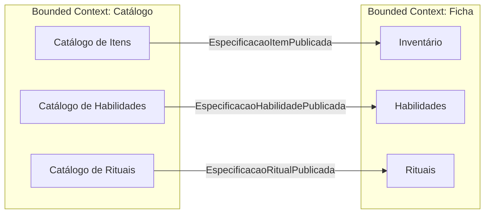

# Context Map

No incremento do inventário, personagem e ficha ainda não existem. A verificação usa sete usuários já provisionados (um admin e seis jogadores), cada um com um inventário já criado, sem função de criar ficha. O desenho abaixo é a fronteira quando catálogo e ficha estiverem no modelo.

